# Marketplace Documentation Hub

Welcome to the centralized documentation hub for the **Freelance Marketplace Platform**. This portal provides comprehensive, production-grade technical specifications, architecture blueprints, API contracts, and operational runbooks for both frontend and backend engineers.

---

## 🧭 Master Documentation Map

```mermaid
flowchart TD
    Hub[Marketplace Documentation Hub]
    
    Hub --> Plans[1. Strategic Roadmaps & Plans]
    Hub --> Backend[2. Backend System Specification]
    Hub --> Frontend[3. Frontend Architecture & Design]
    Hub --> API[4. API Reference & Contracts]
    Hub --> Ops[5. SRE Operations & Runbooks]

    Plans --> P1[Admin Panel Plan]
    Plans --> P2[Server Architecture Plan]
    Plans --> P3[Backend v1 Roadmap]

    Backend --> B1[System Architecture & Design]
    Backend --> B2[Data Topology & Prisma Schema]
    Backend --> B3[Auth & Staff RBAC]
    Backend --> B4[Escrow & FinOps Ledger]
    Backend --> B5[Proposals & Real-Time Chat]
    Backend --> B6[Disputes & Moderation]

    Frontend --> F1[UI/UX Creative Design Directive]
    Frontend --> F2[Engineering Work Patterns]

    API --> A1[Endpoints Catalog]
    API --> A2[JSON Request/Response Schemas]
    API --> A3[Error Code Dictionary]

    Ops --> O1[SRE Incident Runbooks]
    Ops --> O2[Emergency Circuit Breakers]
    Ops --> O3[Environment Variables Matrix]
```

---

## 1. Strategic Roadmaps & Execution Plans
* [Admin Panel Command Center Plan](file:///e:/Web%20Dev/startup/marketplace/docs/plans/admin-panel-plan.md) — Two-phase blueprint for the staff back-office portal (`frontend/app/admin`).
* [Server & Infrastructure Architecture Plan](file:///e:/Web%20Dev/startup/marketplace/docs/plans/server-architecture-plan.md) — Backend hardening roadmap covering Phase 1 launch and Phase 2 enterprise features.
* [Backend v1 Initial Roadmap](file:///e:/Web%20Dev/startup/marketplace/docs/plans/backend-v1-roadmap.md) — Historical milestone plan for the NestJS core foundation.

---

## 2. Backend Architecture & Domain Guides
* [System Design & Layer Pipeline](file:///e:/Web%20Dev/startup/marketplace/docs/backend/architecture/system-design.md) — Sub-service modularity (<120 LOC), guards, and Redis/PostgreSQL layers.
* [Database Relational Topology](file:///e:/Web%20Dev/startup/marketplace/docs/backend/architecture/data-topology.md) — Prisma models, Mermaid ER diagrams, and compound indexing strategies.
* [SQL Schema Diagrams](file:///e:/Web%20Dev/startup/marketplace/docs/backend/architecture/sql-diagrams.md) — Relational schema mapping and cascade rules.
* [Authentication & Staff RBAC](file:///e:/Web%20Dev/startup/marketplace/docs/backend/domains/auth-and-rbac.md) — Customer vs. Admin tokens, RFC 6238 TOTP 2FA, and sliding-window rate limiting.
* [Escrow Contracts & FinOps Ledger](file:///e:/Web%20Dev/startup/marketplace/docs/backend/domains/escrow-and-finops.md) — 7-Step escrow lifecycle, SSLCommerz IPN, and bKash/Nagad payouts.
* [Proposals & Real-Time Workrooms](file:///e:/Web%20Dev/startup/marketplace/docs/backend/domains/proposals-and-chat.md) — Bidding rules, pre-hire candidate chat, and Socket.io WebSockets.
* [Disputes & Content Moderation](file:///e:/Web%20Dev/startup/marketplace/docs/backend/domains/disputes-and-moderation.md) — Arbitration court, evidentiary dossiers, and anti-circumvention regex.

---

## 3. Frontend Architecture & Design Guidelines
* [Frontend App Router Architecture](file:///e:/Web%20Dev/startup/marketplace/docs/frontend/README.md) — Next.js 16 App Router, domain-driven feature slices, and Server Components.
* [Creative UI/UX Design System](file:///e:/Web%20Dev/startup/marketplace/docs/frontend/design-patterns.md) — Master directive for elite visual aesthetics, glassmorphism, and color chemistry.
* [Engineering Work Patterns](file:///e:/Web%20Dev/startup/marketplace/docs/frontend/work-patterns.md) — The 120-line ceiling, Orchestrator page pattern, and React 19 rules.

---

## 4. API Reference & Data Contracts
* [Complete REST Endpoints Catalog](file:///e:/Web%20Dev/startup/marketplace/docs/backend/api-reference/endpoints-catalog.md) — Tabular mapping of all API routes, verbs, and guards.
* [Production JSON Request & Response Schemas](file:///e:/Web%20Dev/startup/marketplace/docs/backend/api-reference/request-response-schemas.md) — Copy-paste JSON schemas for critical endpoints.
* [Standardized Machine Error Code Dictionary](file:///e:/Web%20Dev/startup/marketplace/docs/backend/api-reference/error-code-dictionary.md) — Standard machine error envelopes and `ERR_*` codes.

---

## 5. Operations & SRE Runbooks
* [SRE Incident Response Runbooks](file:///e:/Web%20Dev/startup/marketplace/docs/backend/operations/sre-runbooks.md) — Step-by-step playbooks for on-call engineers.
* [Emergency Kill Switches & Circuit Breakers](file:///e:/Web%20Dev/startup/marketplace/docs/backend/operations/emergency-circuit-breakers.md) — Redis kill switches (`KILL_SWITCH_PAYOUTS`, `MAINTENANCE_MODE`).
* [Environment Variables & Security Matrix](file:///e:/Web%20Dev/startup/marketplace/docs/backend/operations/environment-matrix.md) — Secrets configuration and rotation cadences.

---

## 6. Historical Phase Reports
* [Backend Phase History Archive](file:///e:/Web%20Dev/startup/marketplace/docs/backend/phase-history/) — 14 detailed milestone reports documenting the initial system build.
