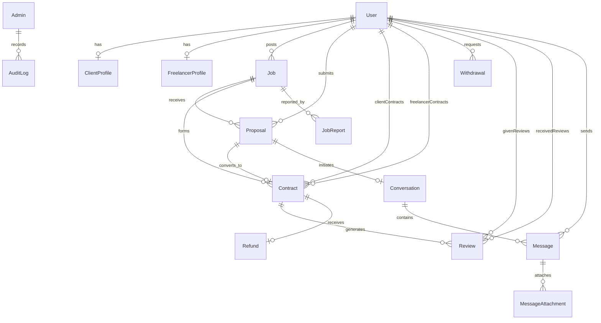

# Database Schema & Relational Data Topology

This document details the relational data model, Entity-Relationship (ER) topology, compound indexes, and foreign key cascades managed via **Prisma ORM** against **PostgreSQL**.

---

## 1. Visual Entity-Relationship (ER) Topology

---

## 2. High-Performance Compound Indexing Matrix

To guarantee sub-millisecond query execution and eliminate table scans on large tables, the following compound indexes are defined in `schema.prisma`:

| Table | Index Columns | Purpose |
|---|---|---|
| `Contract` | `[status, createdAt]` | Sub-second active escrow listings and admin queues |
| `Contract` | `[clientId, status]` | Rapid retrieval of client contracts filtered by state |
| `Contract` | `[freelancerId, status]` | Rapid retrieval of freelancer contracts filtered by state |
| `Withdrawal` | `[status, createdAt]` | Optimized administrative payout queue processing |
| `Withdrawal` | `[freelancerId]` | Fast freelancer withdrawal history queries |
| `AuditLog` | `[targetType, targetId]`| Instant timeline lookup for specific entity audits |
| `AuditLog` | `[adminId]`, `[action]` | Staff activity filtering and security reviews |
| `Job` | `[status, createdAt]` | Public marketplace job discovery with pagination |
| `Job` | `[categoryId, subCategoryId]` | Category and taxonomy faceted filtering |
| `Message` | `[conversationId, createdAt]`| Chronological workroom chat transcript rendering |
| `Proposal` | `[jobId, status]` | Client candidate list sorted by proposal state |

---

## 3. Strict Relational Invariants & Precision

* **Decimal Currency Precision:** All financial fields (`budget`, `bidAmount`, `escrowAmount`, `platformFee`, `walletBalance`, `amount`) are stored as PostgreSQL `NUMERIC(12, 2)` / Prisma `Decimal(12, 2)`. This eliminates IEEE floating-point rounding errors.
* **Proposal Uniqueness:** `@@unique([jobId, freelancerId])` guarantees a freelancer can only submit one active bid per job posting.
* **Review Single-Submission:** `@@unique([contractId, reviewerId])` prevents double feedback submission on completed contracts.
