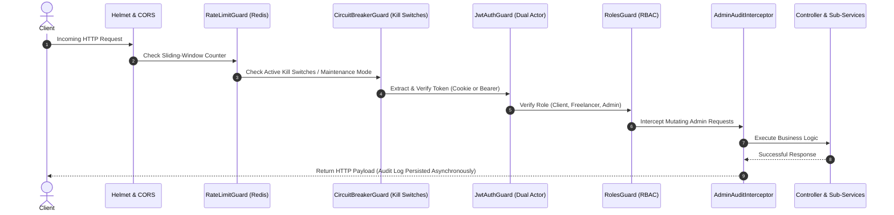

# Backend Architecture & System Design

This document details the high-level architecture, layer pipeline, and service decomposition patterns powering the Marketplace backend.

---

## 1. System Topology & Request Pipeline

```
+-----------------------------------------------------------------------------------+
|                                CLIENT APPLICATION                                  |
|     (Freelancer Web / Client Web / Mobile Web / Admin Back-Office Portal)          |
+-----------------------------------------+-----------------------------------------+
                                          |
                                          v
+-----------------------------------------------------------------------------------+
|                           SECURITY & GUARD PIPELINE                               |
|  [Helmet Headers] -> [Strict CORS] -> [Sliding-Window Redis Rate Limiter]         |
|       -> [CircuitBreakerGuard] -> [JwtAuthGuard] -> [RolesGuard]                  |
+-----------------------------------------+-----------------------------------------+
                                          |
                                          v
+-----------------------------------------------------------------------------------+
|                             API CONTROLLER LAYER                                  |
|   /auth       /admin/auth   /users      /jobs       /proposals    /chat           |
|   /contracts  /reviews      /wallet     /categories /admin/*      WebSocket       |
+-----------------------------------------+-----------------------------------------+
                                          |
                                          v
+-----------------------------------------------------------------------------------+
|                        SUB-SERVICE ARCHITECTURE LAYER                             |
|  High-complexity domains split into single-responsibility sub-services (<120 LOC) |
|  coordinated by lean facades (e.g., ContractsService, WalletService, ChatService) |
+-------------------+---------------------------------------+-----------------------+
                    |                                       |
                    v                                       v
+-------------------------------------+   +-----------------------------------------+
|     POSTGRESQL (via Prisma ORM)     |   |          REDIS CACHE & QUEUES           |
|  - Actor Segregation (Admin vs User)|   |  - Token Revocation & Sessions          |
|  - Escrow Contracts & Ledgers       |   |  - Sliding-Window Rate Limit Counters   |
|  - Real-time Chat Threads & Messages|   |  - Proposals Queue (Anti-Circumvention) |
|  - Taxonomy, Reviews, Audit Logs    |   |  - Messages Queue (Offline Alerts)      |
+-------------------------------------+   +-----------------------------------------+
```

---

## 2. The Sub-Service Modularity Pattern (<120 LOC)

To eliminate bloated monolithic service classes ("God Objects"), complex domains use a **Facade + Specialized Sub-Services** pattern:

### Example: Escrow Contracts Domain
* **`ContractsService` (Facade):** Exposes clean, high-level methods to the controller, validating DTO inputs and coordinating sub-services.
* **`ContractFormationSubService` (<120 LOC):** Handles contract creation, proposal acceptance, and auto-rejection of competing bids.
* **`ContractApprovalSubService` (<120 LOC):** Handles work submission, milestone completion, fee deductions, and net payout distribution.
* **`ContractQuerySubService` (<120 LOC):** Handles optimized database queries with targeted `select` / `include` trees to avoid N+1 queries.
* **`SslCommerzService` (<120 LOC):** Manages payment gateway initialization and IPN server-to-server webhook verification.

---

## 3. Global Interceptor & Guard Pipeline

The request lifecycle executes in a strict, hardened sequence:


