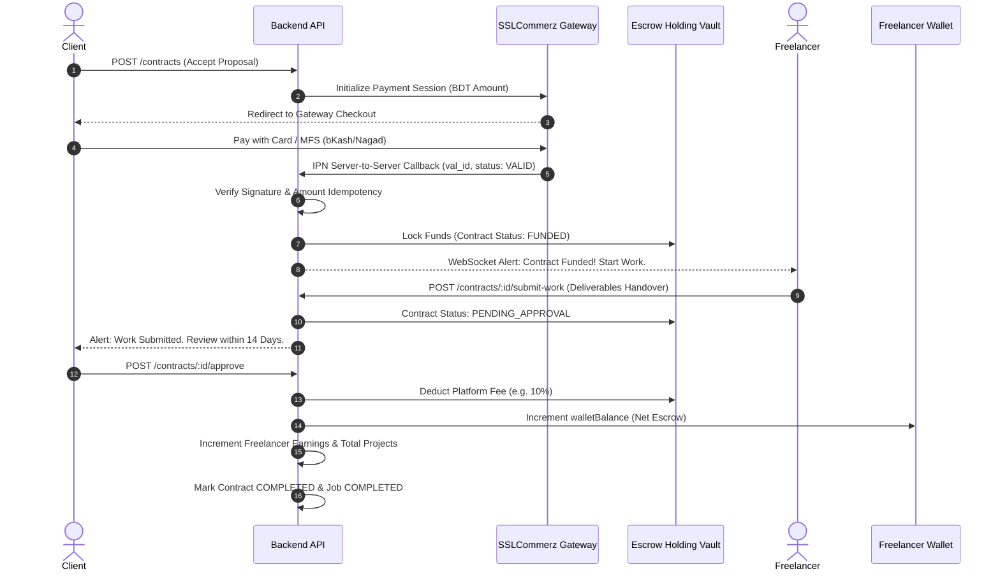

# Escrow Contracts & FinOps Ledger Engine

This document details the financial architecture, escrow holding vaults, SSLCommerz gateway integration, and mobile money payouts (bKash & Nagad).

---

## 1. The 7-Step Escrow Lifecycle

---

## 2. Financial Integrity & Zero-Drift Invariants

1. **Atomic Fee Calculation:** Platform fee percentage is dynamically fetched from `PlatformSetting` (default: 10.0%). Net payout is calculated with exact decimal precision:
   $$\text{Platform Fee} = \text{round}\left(\text{Escrow Amount} \times \frac{\text{Fee Percentage}}{100}, 2\right)$$
   $$\text{Net Payout} = \text{Escrow Amount} - \text{Platform Fee}$$
2. **Double-Spend Prevention on Approval:** Contract state transition from `PENDING_APPROVAL` to `COMPLETED` is guarded inside an atomic `$transaction`. If the contract is already completed, the transaction aborts with `409 Conflict`.
3. **Idempotent Gateway Webhook:** Server-to-server IPN callbacks check `Contract.sslcommerzId`. Duplicate callbacks return `200 OK` without re-crediting or re-triggering events.

---

## 3. Payouts & Mobile Money Ledger (bKash/Nagad)

### Freelancer Withdrawal Flow:
1. **Request Submission:** Freelancer initiates payout via `POST /wallet/withdraw`.
2. **Instant Balance Reservation:** The requested amount is immediately deducted from `user.walletBalance` inside a transaction, creating a `Withdrawal` with status `PENDING`. This eliminates any possibility of withdrawing the same balance twice.
3. **Administrative Processing Queue (`/admin/withdrawals`):**
   * **Approval (`PATCH /admin/withdrawals/:id/approve`):** Staff enters external MFS transaction reference (e.g. `BKASH-TX-98412`). The record transitions to `APPROVED`.
   * **Rejection (`PATCH /admin/withdrawals/:id/reject`):** Staff rejects the payout with a mandatory reason. The service **atomically increments the freelancer's wallet balance**, restoring their funds completely.
