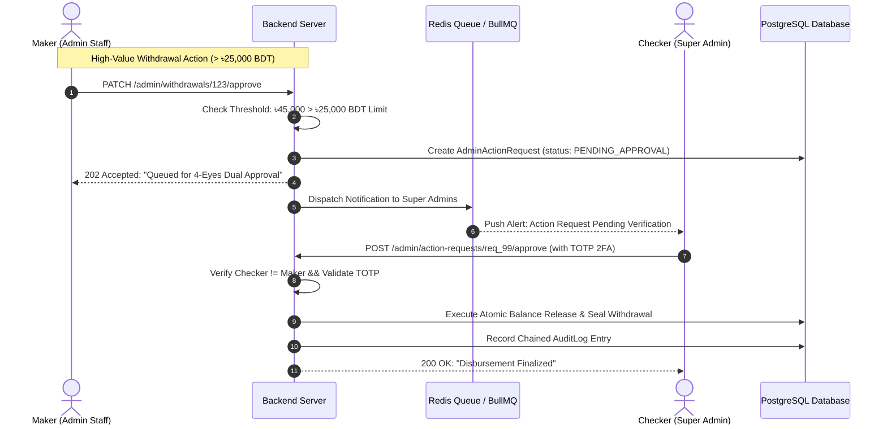

# Marketplace Backend Server & Infrastructure — Comprehensive Architecture Plan

This document establishes the complete, production-grade backend architecture, security controls, financial integrity safeguards, and implementation roadmap for the **Marketplace Backend Server** (`backend/src`).

It is structured into two distinct execution horizons:
* **Phase 1: Launch-Ready Production Core (Implement Now):** Everything required to safely launch, secure financial ledger transactions, enforce strict staff RBAC with 2FA, safeguard escrow funds, arbitrate disputes, monitor anti-circumvention, provide emergency kill switches, and record immutable audit logs.
* **Phase 2: Enterprise Resiliency & Autonomous Risk Engine (Post-Launch):** Advanced enterprise capabilities including Maker-Checker (4-eyes) dual authorization, real-time device/IP collusion detection, automated SLA sweepers, visual JSON state-diff auditing, read-only scoped user impersonation, and cryptographic audit log chaining.

---

```mermaid
flowchart TD
    subgraph Phase 1: Launch-Ready Production Core
        S1[1. Unified Admin RBAC, Token Isolation & TOTP 2FA]
        S2[2. FinOps & Escrow Financial Integrity Hardening]
        S3[3. Emergency Kill Switches & Platform Circuit Breakers]
        S4[4. Dispute Arbitration Engine & Evidence Assembly]
        S5[5. Content Moderation & Anti-Circumvention Pipeline]
        S6[6. Automatic Mutation Audit Interceptor & Security Telemetry]
        S7[7. DB Compound Indexing, Connection Pooling & Health Checks]
    end

    subgraph Phase 2: Enterprise Resiliency & Autonomous Risk Engine
        E1[1. Maker-Checker 4-Eyes Dual Authorization State Machine]
        E2[2. Real-Time Device Fingerprint & IP Collusion Scoring]
        E3[3. Automated Escrow Sweeper & SLA Cron Daemon BullMQ]
        E4[4. High-Precision RFC 6902 JSON State-Diff Audit Engine]
        E5[5. Scoped & Watermarked Read-Only Impersonation Tokens]
        E6[6. Zero-Trust Network Hardening & Cryptographic Audit Chaining]
    end

    Phase 1 -->|Continue to Launch| Launch((Production Marketplace Launch))
    Launch --> Phase 2
```

---

## Part 1: Phase 1 — Launch-Ready Production Core (Execute Now)

### 1. Architectural Structure & Module Tree
The backend admin and financial security services are organized cleanly within NestJS modules:

```
backend/src/
├── admin/
│   ├── admin.module.ts                   # Unified Admin aggregator module
│   ├── auth/                             # Admin authentication, TOTP 2FA & JWT tokens
│   │   ├── admin-auth.controller.ts
│   │   ├── admin-auth.service.ts
│   │   ├── guards/
│   │   │   ├── admin-auth.guard.ts       # Validates Admin JWT (userType: 'ADMIN')
│   │   │   └── admin-roles.guard.ts      # Enforces AdminRole (SUPER_ADMIN, ADMIN, MODERATOR, SUPPORT)
│   │   └── services/
│   │       ├── admin-auth-credentials-sub.service.ts
│   │       ├── admin-auth-tokens-sub.service.ts
│   │       └── admin-2fa.service.ts      # otplib TOTP generation & verification
│   ├── analytics/                        # Executive telemetry, GMV & TVL aggregations
│   ├── audit/                            # Immutable audit logging engine
│   │   ├── interceptors/
│   │   │   └── admin-audit.interceptor.ts# Intercepts POST/PUT/PATCH/DELETE mutations
│   │   └── services/
│   │       └── audit-logger.service.ts
│   ├── disputes/                         # Arbitration court & evidence assembly
│   │   ├── controllers/admin-disputes.controller.ts
│   │   └── services/
│   │       ├── admin-disputes-query.service.ts
│   │       └── admin-disputes-verdicts.service.ts
│   ├── moderation/                       # Flagged jobs, chat circumvention scanning
│   ├── users/                            # User directory, bans, KYC & status toggling
│   └── settings/                         # Platform commission %, fees, circuit breakers
│       ├── controllers/admin-settings.controller.ts
│       └── services/admin-settings.service.ts
├── common/
│   ├── guards/
│   │   └── circuit-breaker.guard.ts      # Emergency kill switch enforcement
│   └── interceptors/
│       └── correlation-id.interceptor.ts # Structured logging with x-request-id
└── wallet/
    ├── controllers/
    │   └── admin-withdrawals.controller.ts # bKash/Nagad payout approval & reject
    └── services/
        └── wallet.service.ts             # Atomic ledger transactions
```

---

### 2. Module Specifications (Phase 1)

#### Module 1.1: Unified Admin RBAC, Token Isolation & TOTP 2FA Enforcement
* **Cryptographic Token Isolation:**
  * Admin JWT tokens use dedicated environment secrets (`JWT_ADMIN_ACCESS_SECRET`, `JWT_ADMIN_REFRESH_SECRET`) completely segregated from customer user tokens.
  * Access token lifetime: **24 hours**; refresh token lifetime: **7 days** with SHA-256 hash persisted in Redis (`admin:refresh:<adminId>`).
* **TOTP Two-Factor Authentication (`otplib`):**
  * `POST /admin/auth/2fa/generate`: Generates an authenticator URI and QR code (Base64) with cryptographic secret stored encrypted in `Admin.twoFactorSecret`.
  * `POST /admin/auth/2fa/verify`: Validates 6-digit TOTP code and marks `Admin.twoFactorEnabled = true`.
  * `POST /admin/auth/login`: If `twoFactorEnabled === true`, issues a temporary pre-auth session token requiring `POST /admin/auth/2fa/authenticate` to obtain full access cookies.
* **Granular Staff Guards:**
  * `@AdminRoles(AdminRole.SUPER_ADMIN, AdminRole.ADMIN)` decorator applied across all financial and arbitration endpoints.
  * `SUPPORT` role restricted strictly to viewing dossiers and user statuses without fund release permissions.

#### Module 1.2: FinOps & Escrow Financial Integrity Hardening
* **Atomic PostgreSQL Transactions (`$transaction`):**
  * All balance mutations (escrow funding, dispute refund, dispute release, payout approval, payout refund) are strictly wrapped in atomic Prisma transactions to ensure zero state divergence.
* **Double-Spend & Concurrency Protection:**
  * Withdrawal approvals (`PATCH /admin/withdrawals/:id/approve`) and rejections verify status `PENDING` within the atomic transaction. If status has already transitioned, rejects with `409 Conflict`.
  * Wallet deductions utilize Prisma atomic decrements (`walletBalance: { decrement: amount }`) with runtime assertion that `walletBalance >= 0`.
* **SSLCommerz IPN (Instant Payment Notification) Webhook Verification:**
  * Secure server-to-server validation against SSLCommerz validation API (`https://sandbox.sslcommerz.com/validator/api/validationserverAPI.php` / live endpoint).
  * Validates transaction amount (`val_id`), currency (`BDT`), and status (`VALID` or `VALIDATED`).
  * Idempotency check: Confirms `Contract.sslcommerzId` is not already processed before setting `status = FUNDED`.
* **Financial Ledger Reconciliation Endpoint:**
  * `GET /admin/analytics/reconciliation`: Sums all user wallet balances + active contract escrow TVL and compares against recorded SSLCommerz deposits minus approved payouts. Returns a real-time variance report.

#### Module 1.3: Emergency Kill Switches & Platform Circuit Breakers
* **Redis-Backed Real-Time Flags:**
  * `KILL_SWITCH_PAYOUTS`: Halts all withdrawal creation (`POST /wallet/withdraw`) and execution.
  * `KILL_SWITCH_ESCROW`: Halts new contract creations and payment initiation.
  * `MAINTENANCE_MODE`: Returns `503 Service Unavailable` with friendly downtime payload to all non-admin routes (`/admin/*` remains fully accessible to staff).
* **Zero-Latency In-Memory Circuit Breaker Guard:**
  * `CircuitBreakerGuard` reads flags from Redis with a local 5-second in-memory cache to guarantee zero database/network latency on high-throughput client requests.
* **Staff Control Endpoints:**
  * `GET /admin/settings/circuit-breakers`: Current status of all kill switches.
  * `POST /admin/settings/circuit-breakers/toggle`: Toggles any kill switch with mandatory staff reason recorded directly in the audit log.

#### Module 1.4: Dispute Arbitration Engine & Evidence Assembly
* **Dossier Compilation Endpoint (`GET /admin/disputes/:id`):**
  * Aggregates:
    1. Contract metadata (`escrowAmount`, `platformFee`, milestone history, dates).
    2. Client Profile (company name, total spent, dispute history).
    3. Freelancer Profile (skills, earnings, rating, completed projects).
    4. Workroom chat messages with chronological timestamps and attached file deliverable URLs.
    5. Work submission handover note and original proposal bid details.
* **Standardized Arbitration Verdict Execution:**
  * **Verdict 1 — Full Refund to Client (`POST /admin/disputes/:id/refund`):**
    * Updates `Contract.status = REFUNDED`, `Job.status = CANCELED`.
    * Atomically credits 100% of `escrowAmount` to client's `walletBalance`.
    * Creates `Refund` record and triggers BullMQ email notification.
  * **Verdict 2 — Full Release to Freelancer (`POST /admin/disputes/:id/release`):**
    * Updates `Contract.status = COMPLETED`, `Job.status = COMPLETED`.
    * Calculates `netPayout = escrowAmount - platformFee`.
    * Atomically credits `netPayout` to freelancer's `walletBalance`, increments `freelancerProfile.earnings` and `totalProjects`.
    * Triggers BullMQ email notification.
  * **Verdict 3 — Proportional Escrow Split (`POST /admin/disputes/:id/split`):**
    * Takes `clientRefundPercentage` (e.g., 40%) and calculates exact client refund vs. freelancer gross payout minus proportionate platform fee.
    * Atomically updates both user wallets in one transaction.

#### Module 1.5: Content Moderation & Anti-Circumvention Pipeline Hardening
* **Anti-Circumvention Rule Engine (`AntiCircumventionService`):**
  * Enhanced regex pattern matching for Bangladeshi mobile numbers: `01[3-9]\d{8}`, international formats (`+8801...`), deceptive spacing (`0 1 7 1 ...`), and Bengali script numerals.
  * Direct contact & off-platform payment keywords: `whatsapp`, `telegram`, `imo`, `personal bkash`, `direct payment`, `pay outside`.
  * Prohibited communication shortlinks: `wa.me`, `t.me`, `api.whatsapp.com`.
* **Asynchronous Queue-Backed Processing (BullMQ):**
  * Proposals and chat messages are checked asynchronously in `ProposalQueueProcessor` and `MessageQueueProcessor` without adding latency to real-time WebSocket deliveries.
  * Flagged items set `isFlagged = true` with detailed `flagReason`.
* **Moderation Admin Endpoints:**
  * `GET /admin/moderation/flagged-messages`: Paginated queue of flagged messages with sender, recipient, and highlighted trigger keywords.
  * `POST /admin/moderation/messages/:id/resolve`: Clears flag or issues account warning.
  * `GET /admin/moderation/reported-jobs`: Queue of jobs flagged by community reports (`JobReport`).

#### Module 1.6: Automatic Mutation Audit Logger & Security Telemetry
* **Global Admin Audit Interceptor (`AdminAuditInterceptor`):**
  * Automatically intercepts every incoming `POST`, `PUT`, `PATCH`, `DELETE` to `/admin/*`.
  * Extracts:
    * `adminId`: UUID of authenticated staff member.
    * `action`: Inferred from route action (e.g., `PAYOUT_APPROVED`, `DISPUTE_REFUND`, `USER_BANNED`).
    * `targetType`: Entity being modified (`USER`, `CONTRACT`, `WITHDRAWAL`, `JOB`, `SETTING`).
    * `targetId`: Extracted from route parameters `:id`.
    * `details`: JSON snapshot of request body and query params (with sensitive fields like passwords/tokens scrubbed).
    * `ipAddress`: Client IP address from `req.ip` or `x-forwarded-for`.
  * Persists directly into `AuditLog` table asynchronously without slowing request response times.
* **Audit Explorer Query Service (`GET /admin/audit`):**
  * Filterable by `adminId`, `action`, `targetType`, and date range with cursor-based pagination.

#### Module 1.7: Production Database Optimization, Indexes & Health Checks
* **PostgreSQL Compound Indexes (`schema.prisma`):**
  * Add compound index `@@index([status, createdAt])` to `Contract` and `Withdrawal` for sub-millisecond admin queue listings.
  * Add `@@index([clientId, status])` and `@@index([freelancerId, status])` for user dossier speed.
  * Add `@@index([isFlagged, createdAt])` for instant moderation queue retrieval.
* **Production Connection Pooling:**
  * Explicit Prisma pool sizing (`connection_limit=20`, `pool_timeout=10`) configured in `DATABASE_URL`.
* **Structured Logging & Correlation IDs:**
  * `CorrelationIdInterceptor` assigns a unique `x-request-id` to every request and injects it into NestJS/Winston logger.
* **System Health Check (`GET /health`):**
  * Verifies live connectivity to:
    1. PostgreSQL database (via `PrismaService.$queryRaw'SELECT 1'`).
    2. Redis cluster (via `RedisService.ping()`).
    3. BullMQ queues status (active/delayed job counts).

---

## Part 2: Phase 2 — Enterprise Resiliency & Autonomous Risk Engine (Post-Launch)

Following marketplace launch and initial transaction volume, Phase 2 implements advanced enterprise controls to protect platform treasury, detect bad actors autonomously, and scale operations.



---

### 3. Module Specifications (Phase 2)

#### Module 2.1: Maker-Checker (4-Eyes) Dual Authorization State Machine
* **Prisma Schema Extension:**
  ```prisma
  enum ActionRequestStatus {
    PENDING_APPROVAL
    APPROVED
    REJECTED
    EXPIRED
  }

  model AdminActionRequest {
    id            String              @id @default(uuid())
    actionType    String              // "HIGH_VALUE_PAYOUT", "FEE_CHANGE", "USER_UNBAN", "ARBITRATION_OVERRIDE"
    makerId       String
    maker         Admin               @relation("MakerActions", fields: [makerId], references: [id])
    checkerId     String?
    checker       Admin?              @relation("CheckerActions", fields: [checkerId], references: [id])
    targetType    String
    targetId      String?
    payload       Json                // Exact payload to execute
    status        ActionRequestStatus @default(PENDING_APPROVAL)
    rejectionReason String?
    expiresAt     DateTime
    createdAt     DateTime            @default(now())
    updatedAt     DateTime            @updatedAt

    @@index([status, createdAt])
    @@index([makerId])
  }
  ```
* **Execution Interceptor:**
  * High-risk operations (withdrawals > ৳25,000 BDT, platform fee changes, user unbans) automatically intercept the direct call and create an `AdminActionRequest`.
  * The maker cannot self-approve (`checkerId !== makerId`).
  * Checker approval requires verification of 6-digit TOTP code before the database transaction executes the stored payload.

#### Module 2.2: Real-Time Device Fingerprint & IP Collusion Scoring
* **Telemetry Data Collection:**
  * Records client and freelancer request headers: IP address, `User-Agent`, and client-side device hash (Canvas/WebGL fingerprint).
* **Collusion Detection Engine (`CollusionDetectorService`):**
  * Evaluates contract parties against fraud heuristics:
    1. **IP Collision:** Client and freelancer share identical public IP or `/24` subnet.
    2. **Device Match:** Same browser fingerprint used on both accounts.
    3. **Payment Source Overlap:** Matching card fingerprint or identical bKash/Nagad funding accounts.
* **Risk Score Calculation (0 – 100):**
  * Contracts scoring > 65 are flagged with `isHighRisk: true`. Escrow releases are held in a 24-hour verification escrow quarantine for staff sign-off.

#### Module 2.3: Automated Escrow Sweeper & SLA Cron Daemon (BullMQ)
* **Automated Cron Jobs:**
  * **Job 1 — Review SLA Auto-Approval Sweeper (`ContractReviewSweeper`):**
    * Runs every hour. Finds contracts in `PENDING_APPROVAL` status submitted > 14 days ago where the client has been inactive.
    * Automatically triggers `completeContract`, releases funds to freelancer, records `SYSTEM_AUTO_RELEASE` in audit log, and notifies both parties.
  * **Job 2 — Idle Funded Escrow Monitor (`IdleEscrowSweeper`):**
    * Detects contracts funded > 30 days ago with zero messages or deliverables submitted. Dispatches warning emails to both parties.
  * **Job 3 — Daily Financial Reconciliation Cron (`DailyFinOpsAuditJob`):**
    * Runs daily at 00:00 UTC. Compares physical bank balances against ledger TVL. If discrepancy > ৳0.00, fires high-priority alert to engineering.

#### Module 2.4: High-Precision RFC 6902 JSON State-Diff Audit Engine
* **Prisma Middleware / Extension:**
  * On every mutating query (`update`, `delete`), captures previous state snapshot and new state snapshot.
  * Generates standard RFC 6902 JSON patch operations:
    ```json
    [
      { "op": "replace", "path": "/status", "oldValue": "PENDING", "value": "APPROVED" },
      { "op": "replace", "path": "/walletBalance", "oldValue": "5400.00", "value": "1400.00" }
    ]
    ```
  * Stored in `AuditLog.stateDiff`, enabling visual side-by-side before/after comparison in the frontend admin inspector.

#### Module 2.5: Scoped & Watermarked Read-Only Impersonation Tokens
* **Security Token Architecture:**
  * `POST /admin/users/:id/impersonate` generates a scoped JWT containing:
    ```json
    {
      "sub": "user_123",
      "role": "FREELANCER",
      "isImpersonated": true,
      "impersonatedByAdminId": "admin_456",
      "readOnly": true
    }
    ```
  * Token validity is restricted to **15 minutes**.
* **Global Read-Only Guard:**
  * A global NestJS guard blocks any `POST`, `PUT`, `PATCH`, `DELETE` request originating from an impersonation token with `403 Forbidden ("Impersonation sessions are strictly read-only")`.
  * Prevents accidental or rogue administrative alterations under a customer's identity.

#### Module 2.6: Zero-Trust Network Hardening & Cryptographic Audit Chaining
* **Network Perimeter Controls:**
  * Restricts `/admin/*` endpoints to designated office CIDR blocks or validates Cloudflare Access identity headers (`Cf-Access-Jwt-Assertion`).
* **Tamper-Evident Chained Audit Ledger:**
  * Extends `AuditLog` with `prevHash` and `entryHash`.
  * `entryHash = SHA256(prevHash + id + adminId + action + targetId + timestamp + JSON.stringify(details))`.
  * Any direct database tampering (e.g. rogue DBA modifying or deleting an audit record) breaks the cryptographic chain and triggers an alert on the next integrity check.

---

## Part 3: Phase 1 Implementation Schedule & Milestones

The following sequential milestones guide the Phase 1 backend implementation:

### Milestone 1: Staff Auth & Access Control Hardening
- [ ] Implement `admin-2fa.service.ts` using `otplib` (QR code generation, secret generation, 6-digit TOTP verification).
- [ ] Add 2FA endpoints to `AdminAuthController` (`/2fa/generate`, `/2fa/verify`, `/2fa/authenticate`).
- [ ] Create unified `AdminAuthGuard` and `AdminRolesGuard` checking `AdminRole` enum.
- [ ] Secure all admin route handlers with `@UseGuards(AdminAuthGuard, AdminRolesGuard)`.

### Milestone 2: FinOps & Escrow Financial Integrity
- [ ] Update `admin-withdrawals.controller.ts` to enforce status validation (`PENDING`) and atomic transaction execution.
- [ ] Verify SSLCommerz IPN webhook validation and idempotency checking.
- [ ] Create financial reconciliation query endpoint `GET /admin/analytics/reconciliation`.

### Milestone 3: Emergency Kill Switches & Circuit Breakers
- [ ] Implement Redis-backed `CircuitBreakerService` with flags `KILL_SWITCH_PAYOUTS`, `KILL_SWITCH_ESCROW`, `MAINTENANCE_MODE`.
- [ ] Implement `CircuitBreakerGuard` with 5-second in-memory caching.
- [ ] Add control endpoints `GET /admin/settings/circuit-breakers` and `POST /admin/settings/circuit-breakers/toggle`.

### Milestone 4: Dispute Arbitration Evidence & Dossier Assembly
- [ ] Create `GET /admin/disputes/:id` compiling full dossier (contract metadata, profiles, chat transcript, deliverables).
- [ ] Verify atomic transaction logic for Full Refund, Full Release, and Split Settlement.
- [ ] Integrate BullMQ email notification triggers upon dispute resolution.

### Milestone 5: Content Moderation & Anti-Circumvention Pipeline
- [ ] Enhance regex matching in `AntiCircumventionService` for Bangladeshi phone numbers and prohibited external channels.
- [ ] Create moderation endpoints: `GET /admin/moderation/flagged-messages` and `POST /admin/moderation/messages/:id/resolve`.
- [ ] Wire queue processors to flag violations asynchronously.

### Milestone 6: Automatic Mutation Audit Logger & Security Telemetry
- [ ] Implement `AdminAuditInterceptor` to capture every mutating admin HTTP request.
- [ ] Persist `AuditLog` records with `adminId`, `action`, `targetType`, `targetId`, `details`, and `ipAddress`.
- [ ] Provide queryable `GET /admin/audit` with filtering and pagination.

### Milestone 7: Database Indexes & Health Verification
- [ ] Apply compound indexes to `schema.prisma` (`Contract`, `Withdrawal`, `Message`, `AuditLog`).
- [ ] Configure PostgreSQL connection pool settings for production.
- [ ] Implement `GET /health` checking PostgreSQL, Redis, and BullMQ connectivity.

---

## Part 4: Backend API Endpoints Reference Matrix

| Method | Endpoint | Phase | Role Guard | Description |
|---|---|---|---|---|
| `POST` | `/admin/auth/login` | 1 | Public | Staff email/password login (checks 2FA status) |
| `POST` | `/admin/auth/2fa/authenticate` | 1 | Public | Verifies 6-digit TOTP code and sets admin session cookies |
| `POST` | `/admin/auth/2fa/generate` | 1 | `ADMIN` | Generates 2FA secret and QR code |
| `POST` | `/admin/auth/2fa/verify` | 1 | `ADMIN` | Confirms and activates 2FA on staff account |
| `GET` | `/admin/analytics/summary` | 1 | `ADMIN` | Retrieves GMV, Escrow TVL, net revenue & user stats |
| `GET` | `/admin/analytics/reconciliation` | 1 | `SUPER_ADMIN` | Real-time ledger reconciliation vs. payment gateway |
| `GET` | `/admin/withdrawals` | 1 | `ADMIN` | Paginated queue of requested bKash/Nagad payouts |
| `PATCH` | `/admin/withdrawals/:id/approve` | 1 | `ADMIN` | Approves withdrawal with MFS transaction reference |
| `PATCH` | `/admin/withdrawals/:id/reject` | 1 | `ADMIN` | Rejects withdrawal and atomically refunds wallet |
| `GET` | `/admin/disputes` | 1 | `ADMIN` | Lists all active disputes with status filters |
| `GET` | `/admin/disputes/:id` | 1 | `ADMIN` | Comprehensive dispute dossier & workroom transcript |
| `POST` | `/admin/disputes/:id/refund` | 1 | `ADMIN` | Forces 100% refund of escrow back to client |
| `POST` | `/admin/disputes/:id/release` | 1 | `ADMIN` | Forces net payment release to freelancer |
| `POST` | `/admin/disputes/:id/split` | 1 | `ADMIN` | Proportional split settlement between parties |
| `GET` | `/admin/users` | 1 | `ADMIN` | Paginated user directory with role & KYC filters |
| `PATCH` | `/admin/users/:id/status` | 1 | `ADMIN` | Bans or unbans a user account with audit reason |
| `GET` | `/admin/moderation/flagged-messages` | 1 | `MODERATOR` | Flagged circumvention chat messages queue |
| `GET` | `/admin/moderation/reported-jobs` | 1 | `MODERATOR` | User-reported jobs queue |
| `GET` | `/admin/settings/circuit-breakers` | 1 | `ADMIN` | Status of emergency kill switches |
| `POST` | `/admin/settings/circuit-breakers/toggle` | 1 | `SUPER_ADMIN`| Activates/deactivates emergency kill switches |
| `GET` | `/admin/audit` | 1 | `ADMIN` | Filterable, immutable audit trail records |
| `GET` | `/health` | 1 | Public | Production database, Redis & queue health check |
| `GET` | `/admin/action-requests` | 2 | `ADMIN` | Maker-checker dual approval pending list |
| `POST` | `/admin/action-requests/:id/approve` | 2 | `SUPER_ADMIN`| Checker 4-eyes approval with TOTP 2FA |
| `GET` | `/admin/risk/collusion-radar` | 2 | `ADMIN` | Live IP/device collision & collusion score feed |
| `POST` | `/admin/users/:id/impersonate` | 2 | `SUPER_ADMIN`| Issues 15-min read-only scoped user token |
